<h1 align="center">Neural Word Embeddings</h1>

<p align="center">
  <em>Skip-gram word embeddings with negative sampling, built from scratch: hand-derived gradients, a unigram negative-sampling table, and cosine similarity, nearest-neighbor, and analogy queries.</em>
</p>

<p align="center">
  <a href="https://github.com/adeoluo/neural-word-embeddings/actions/workflows/ci.yml"></a>
  
  
  
  
  
</p>

---

## Motivation

Word embeddings turned natural language processing into a vector problem: represent each
word as a dense vector so that geometry encodes meaning. The skip-gram model with negative
sampling is the method that made this practical. This project implements it **from scratch** - the vocabulary, the negative-sampling distribution, and the **gradient of the
binary logistic objective derived and applied by hand** - with **zero runtime dependencies**
and a deterministic, offline test suite. No autodiff, no numeric libraries: just the math.

## Architecture

<p align="center">
  
</p>

A frequency-ordered **vocabulary** feeds the **skip-gram** trainer, which learns two
embedding matrices by pushing each center word toward its true context words and away from a
few sampled negatives. The center matrix is the word representation; the service answers
similarity and analogy queries from it. See the [ADRs](docs/adr/) for the key decisions.

## How it works

For each (center, context) pair the model maximizes the probability that the pair is real and
minimizes it for a few random "negative" pairs. The objective for one pair is the binary
logistic loss, whose gradient is simple and derived by hand:

```
score = center . context
prediction = sigmoid(score)
gradient = learning_rate * (label - prediction)
center  += gradient * context
context += gradient * center
```

Negatives are drawn from the **unigram distribution raised to the 3/4 power**, the standard
word2vec choice that samples frequent words often but not overwhelmingly.

## Results

> Reproduce with `python -m neural_word_embeddings evaluate`. Category-retrieval accuracy:
> for each word, is its nearest neighbor (by cosine) in the same semantic category?

| Metric | Value |
|---|---:|
| **category-retrieval accuracy** | **1.000** |
| random baseline | 0.176 |

The trained embeddings place **every** word's nearest neighbor in its own semantic category
(royalty, countries, capitals, animals, nature), against a random baseline of 0.176. This is
the standard intrinsic evaluation of embeddings, and the from-scratch model passes it
completely. (Full linear analogies in the `king - man + woman` style need a large natural
corpus; the `analogy` command demonstrates the vector arithmetic, and the honest limit is
noted below.)

## Demonstration

```text
$ python -m neural_word_embeddings similar king
Nearest words to 'king':
  queen        0.94
  prince       0.91
  throne       0.88
  palace       0.85
  crown        0.83
```

## Quickstart

```bash
git clone https://github.com/adeoluo/neural-word-embeddings.git && cd neural-word-embeddings
make setup                    # install dev tooling + pre-commit hooks
make all                      # lint + type-check + test

python -m neural_word_embeddings evaluate                 # category-retrieval accuracy
python -m neural_word_embeddings similar queen            # nearest neighbors
python -m neural_word_embeddings analogy king queen prince
```

Train on your own text:

```python
from neural_word_embeddings import SkipGramModel, TrainingConfig, Vocabulary, tokenize

sentences = ["the cat sat on the mat", "the dog sat on the log", ...]
tokens = [t for s in sentences for t in tokenize(s)]
vocab = Vocabulary(tokens, min_count=1)
model = SkipGramModel(vocab, TrainingConfig(dimension=64, epochs=10))
model.train([vocab.encode(tokenize(s)) for s in sentences])
print(model.most_similar("cat", k=5))
```

## Running the service

A dependency-free HTTP service trains the embeddings once at startup and serves queries:

```bash
python -m neural_word_embeddings serve --port 8000

curl localhost:8000/health
curl -s -X POST localhost:8000/similar -d '{"word": "king", "k": 5}'
curl -s -X POST localhost:8000/analogy -d '{"a": "king", "b": "queen", "c": "prince"}'
```

See the [operations guide](docs/OPERATIONS.md) for the service contract and constraints.
The service also exposes `GET /ready` (readiness) and `GET /metrics` (per-route request,
error, and latency metrics in Prometheus text format). A production-style stress benchmark
(`uv run python benchmarks/stress.py`) reports throughput and p50/p95/p99 latency; the
scaling path and tradeoffs are in [docs/SCALING.md](docs/SCALING.md) and a full walk-through
is in the [case study](docs/CASE_STUDY.md).

## Components

- **vocabulary** - tokenization and a frequency-ordered vocabulary.
- **linalg** - dependency-free dot product, cosine, and a stable sigmoid.
- **model** - skip-gram with negative sampling and hand-derived gradients.
- **data** - a semantically structured corpus for evaluation.
- **evaluation** - category-retrieval accuracy against a random baseline.

## Design decisions

- **Negative sampling, not full softmax.** A binary logistic objective over a few negatives
  avoids a vocabulary-sized normalization and is what makes training tractable.
  ([ADR-0002](docs/adr/0002-negative-sampling.md))
- **Hand-derived gradients, no autodiff.** The gradient of the logistic objective is written
  out and applied directly, keeping the project dependency-free and fully transparent.
  ([ADR-0003](docs/adr/0003-hand-derived-gradients.md))

## Responsible AI

- **Model card:** [docs/MODEL_CARD.md](docs/MODEL_CARD.md)
- **Data card:** [docs/DATA_CARD.md](docs/DATA_CARD.md)
- **Threat model:** [docs/THREAT_MODEL.md](docs/THREAT_MODEL.md)

## Limitations

- Full linear analogies (`king - man + woman = queen`) need a large natural corpus and many
  dimensions; on the small bundled corpus the model nails nearest-neighbor retrieval but not
  every analogy, which the evaluation reports honestly.
- Training is pure Python, so it is for learning and modest corpora, not web-scale text.
- The vocabulary is closed; out-of-vocabulary words are dropped.

## Roadmap

- [ ] Subsampling of frequent words and dynamic context windows
- [ ] A continuous-bag-of-words objective alongside skip-gram
- [ ] Larger-corpus training with subword units for out-of-vocabulary words

## License

[MIT](LICENSE). Part of an artificial intelligence engineering portfolio by
[adeoluo](https://github.com/adeoluo).
